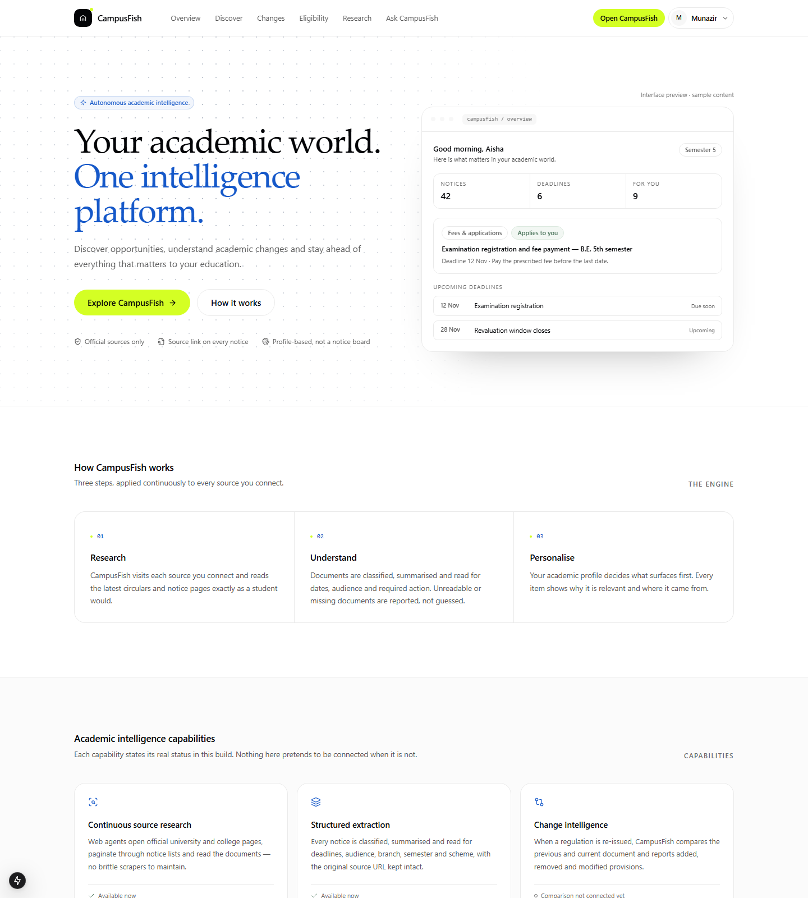
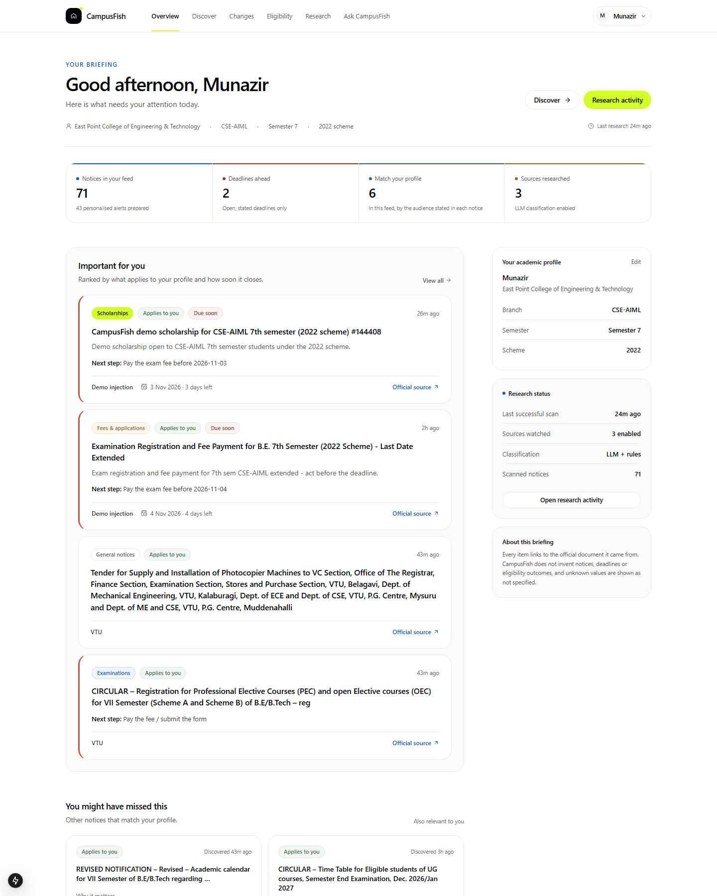
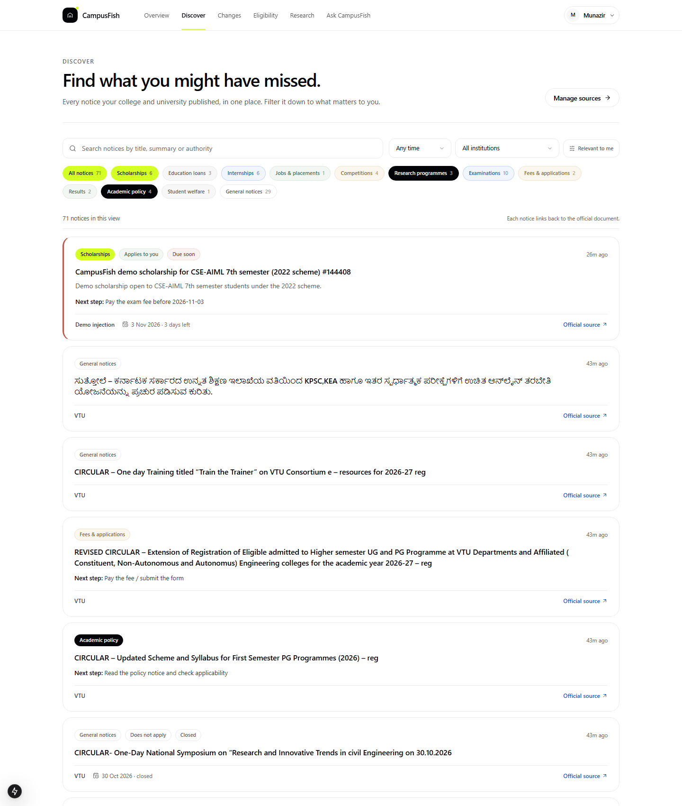
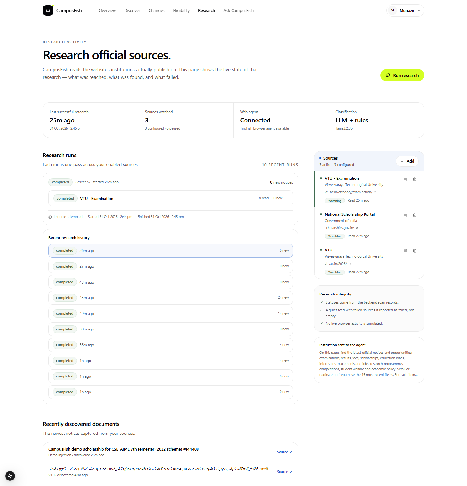

<div align="center">

# 🐟 CampusFish

### Your campus, but nothing slips through.

An AI agent that reads your university and college notice pages, understands what each circular actually means, and messages **you** on Telegram when it affects your branch, semester and scheme.

**Exam timetables · Fee deadlines · Revaluation windows · Results · Scholarships · Internships**

[](#honest-status)
[](https://t.me/CampusFishbot)

<a href="https://tinyfish.ai"></a>



</div>

---

## The problem

Every college runs on notices.

A circular goes up on a dusty portal. A PDF gets buried three clicks deep. Someone finally forwards it to a WhatsApp group — **two days after the deadline**. You find out about the exam fee, the revaluation window, or the scholarship you were eligible for when it's already too late.

The information exists. It's just never *yours*.

## What CampusFish does

Instead of another notice board you have to remember to check, CampusFish works like a student who never sleeps:

| | |
|---|---|
| 🔍 **Watches** | Opens your university and college notice pages, paginates through them, and notices when something new appears. |
| 📄 **Reads** | Opens the circular and its PDF attachments — the same way a person would. No per-site scraper to break. |
| 🧠 **Understands** | Works out what kind of notice it is, who it applies to (branch, semester, scheme), the real deadline, and the one action you need to take. |
| 🎯 **Personalises** | Compares that against *your* profile and your preferences. If it doesn't apply to you, it never reaches your phone. |
| 💬 **Tells you** | Sends a short, friendly Telegram message with the deadline and a link to the official document. |
| 🗣️ **Answers** | Ask "when is my exam fee due?" and get an answer written only from captured official notices, with citations. |

## A day with CampusFish

```
09:00  VTU posts a revised academic calendar
09:02  CampusFish notices the page changed
09:03  The agent opens it, reads it, classifies it
09:03  It checks: does this affect CSE-AIML, semester 7, 2022 scheme?
09:04  Your phone buzzes — summary, deadline, link to the PDF
09:04  You act on it. Two days before the WhatsApp group.
```

## See it

<table>
<tr>
<td width="50%">

### Your dashboard
A calm briefing, not a wall of notices. What matters, what's due, and why it applies to you.



</td>
<td width="50%">

### Discover
Every captured notice in one place, colour-coded by type, filterable, always linked to the original document.



</td>
</tr>
</table>

### Watch the agent work

CampusFish doesn't hide the magic. Open a scan and you can watch the browser agent navigate the portal, page through the archive, and extract the notices — step by step.



## Personal, not broadcast

The same circular means different things to different students.

- **Branch, semester and scheme** are matched against the audience stated in the notice.
- **Your preferences** decide which categories reach your phone at all.
- **Urgency and deadlines** decide what gets highlighted, not what gets spammed.
- **Eligibility details** (income band, category, domicile) are only used when a notice actually states them.
- Everything else stays quietly in the dashboard.

Nothing is sent twice. Every alert links to the official source.

## Ask CampusFish

> "Is there a supplementary exam application for my semester?"
> "What changed in the exam regulations?"
> "Am I eligible for this scholarship?"

Answers are generated **only** from notices CampusFish has captured. If the documents don't cover it, CampusFish says so instead of writing something confident and wrong. Every answer comes with numbered links to the documents used.

## One agent, any portal

CampusFish isn't wired to VTU. Add any university, college, board or scholarship page — a URL is the only configuration. The agent reads the page like a human, so a redesign or a new institution doesn't need new code.

The demo persona is a **VTU student (CSE-AIML, 7th semester, 2022 scheme)**. Point it at your own portal and it works the same way.

---

## Honest status

**Working today**
- Source watching, paginated capture and deduplication
- Agent-driven reading with a fast direct-read path and a live step trace
- Classification, deadline and audience extraction (local model + rules)
- Personalised Telegram alerts with a “does this apply to me?” filter
- Grounded Q&A with citations
- Dashboard, Discover, Changes, Eligibility, Research and Profile

**Deliberately not done**
- No student logins, no form submission, no paying fees for you. The agent is read-only.
- No invented notices, deadlines or eligibility verdicts. Unknown stays unknown.
- No scraping hacks that break when a college redesigns its site.

**Next**
- Scheduled push from TinyFish Monitors into the same alert pipeline
- More sources per student and per-institution onboarding
- Smarter change comparison between revised circulars

---

<details>
<summary><b>Under the hood</b> (for the curious)</summary>

<br />

```
Source URL
   │
   ├─ TinyFish browser agent ── structured JSON of the newest notices
   └─ Direct page read ──────── fast fallback for static notice archives
   │
   ▼
Deduplicate by content hash
   │
   ▼
Classify (rules, then a local LLM) ── category, deadline, audience, urgency
   │
   ▼
Match student profile + preferences + eligibility
   │
   ▼
SQLite ── dashboard ── Telegram (after a short grace period)
```

- **Frontend:** Next.js (App Router), Tailwind, TypeScript
- **Backend:** FastAPI, SQLite, APScheduler
- **Agent:** TinyFish Agent API (async runs, structured output, live step trace)
- **Understanding:** local Ollama model, with rule-based guardrails for dates and urgency
- **Alerts:** Telegram Bot API, with dashboard fallback

A few decisions worth knowing:
- The scan reads the page directly when it can (seconds), while the agent runs alongside for sites that need a real browser and for the live demo.
- LLM deadlines are rejected unless the date literally appears in the source document.
- Alerts wait ~45 seconds so classification can settle before anything is sent.

</details>

<details>
<summary><b>Run it locally</b></summary>

<br />

**You need:** Python 3.11+, Node 18+, [Ollama](https://ollama.com) with `llama3.2:3b`, and a TinyFish API key.

```bash
# 1. Backend
cd backend
python -m venv .venv
.venv\Scripts\activate        # Windows
# source .venv/bin/activate   # macOS / Linux
pip install -r requirements.txt
cp .env.example .env          # add TINYFISH_API_KEY, TELEGRAM_BOT_TOKEN
uvicorn app.main:app --port 8000

# 2. Frontend
cd ../frontend
npm install
npm run dev                   # http://localhost:3000
```

Link Telegram by messaging [@CampusFishbot](https://t.me/CampusFishbot) with `/start <your-user-id>`.

</details>

---

<div align="center">

**CampusFish** — because the notice was always there. You just never saw it.

Built with [TinyFish](https://tinyfish.ai) · FastAPI · Next.js · Ollama

</div>
